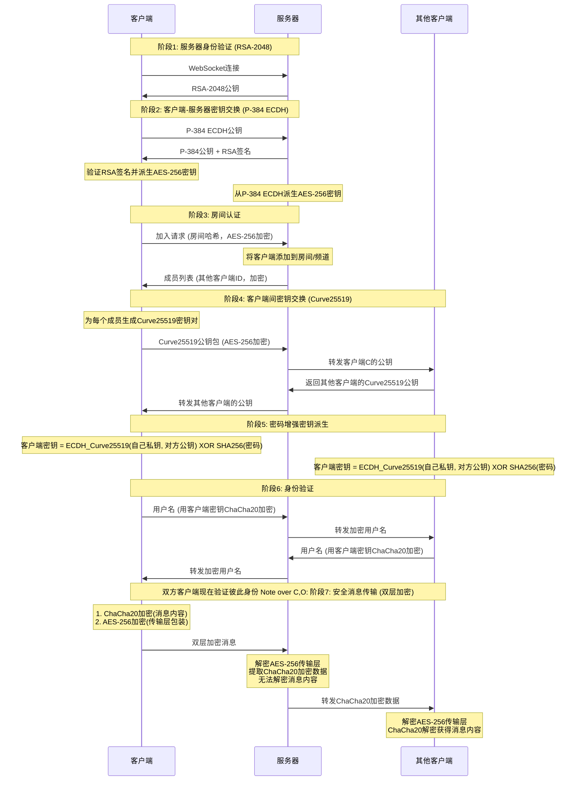

# Whisper

🌐 **[English README](README_EN.md)**

## 🚀 部署说明

### 一键部署到 Cloudflare Workers

点击下方按钮即可一键部署到 Cloudflare Workers：

- 构建命令：npm run build
- 部署命令：npm run deploy
- 

## 📝 项目简介

Whisper 是一个真正的端到端加密聊天系统，实现完全的零知识架构。整个系统设计确保服务器、网络中间人、甚至系统管理员都无法获取任何明文消息内容。所有加密和解密操作都在客户端本地进行，服务器仅作为加密数据的盲中继。

### 系统架构
- **前端**：ES6+ 模块化 JavaScript，无框架依赖
- **后端**：Cloudflare Workers + Durable Objects
- **通信**：WebSocket 实时双向通信
- **构建**：Vite 现代化构建工具

## 🔐 零知识架构设计

### 核心原则
- **服务器盲转**：服务器永远无法解密消息内容，仅负责加密数据中转
- **无数据库存储**：服务器不存储聊天记录；本机浏览器使用临时加密缓存恢复刷新
- **端到端加密**：消息从发送方到接收方全程加密，中间任何环节都无法解密
- **前向安全性**：连接重建时重新协商密钥；刷新缓存使用独立的本地会话密钥加密
- **匿名通信**：用户无需注册真实身份，支持临时匿名聊天
- **多样体验**：和批量发送图片和文件，可选择主题和语言。

### 隐私保护机制

- **实时成员提醒**：房间在线列表完全透明，内任何人加入或离开都会实时通知所有成员，
- **按分享方式查看历史**：普通分享只显示加入后的消息，分享房间和记录可从在线成员获取公共历史
- **私聊加密**：点击用户头像可发起端到端加密的私密对话，房间内其他成员完全无法看到私聊内容

### 房间密码机制

房间密码作为**密钥派生因子**参与端到端加密：`最终共享密钥 = ECDH_共享密钥 XOR SHA256(房间密码)`

- **密码错误隔离**：不同密码的房间无法解密彼此的消息
- **服务器盲区**：服务器永远无法获知房间密码

### 三层安全体系

#### 第一层：RSA-2048 服务器身份验证
- 服务器启动时生成临时 RSA-2048 密钥对，每24小时自动轮换
- 客户端连接时验证服务器公钥，防止中间人攻击
- 私钥仅在服务器内存中存在，从不持久化存储

#### 第二层：ECDH-P384 密钥协商
- 每个客户端生成独立的椭圆曲线密钥对（P-384曲线）
- 通过椭圆曲线 Diffie-Hellman 密钥交换协议建立共享密钥
- 每个客户端与服务器之间拥有独立的加密通道

#### 第三层：混合对称加密
- **服务器通信**：使用 AES-256-CBC 加密客户端与服务器间的控制消息
- **客户端通信**：使用 ChaCha20 加密客户端之间的实际聊天内容
- 每条消息使用独立的初始化向量（IV）和随机数（Nonce）

## 🔄 完整加密流程详解

## 🛠️ 技术实现

- **Web Cryptography API**：浏览器原生加密实现，提供硬件加速
- **elliptic.js**：椭圆曲线密码学库，实现 Curve25519 和 P-384
- **aes-js**：纯 JavaScript AES 实现，支持多种模式
- **js-chacha20**：ChaCha20 流加密算法的 JavaScript 实现
- **js-sha256**：SHA-256 哈希算法实现

## 🔬 安全验证

### 加密过程验证
用户可通过浏览器开发者工具观察完整的加密解密过程，验证消息在传输过程中确实处于加密状态。

### 网络流量分析
使用网络抓包工具可以验证所有 WebSocket 传输的数据都是不可读的加密内容。

### 代码安全审计
所有加密相关代码完全开源，使用标准密码学算法，欢迎安全研究者进行独立审计。

## ⚠️ 安全建议

- **使用强房间密码**：房间密码直接影响端到端加密强度，建议使用复杂密码
- **密码保密性**：房间密码一旦泄露，该房间所有通信内容都可能被解密
- **使用最新版本的现代浏览器**：确保密码学API的安全性和性能

## 🤝 安全贡献

欢迎安全研究者报告漏洞和进行安全审计。严重安全问题将在24小时内修复。

## 📄 开源协议

本项目采用 ISC 开源协议。

## ⚠️ 免责声明

本项目仅供学习和技术研究使用，不得用于任何违法犯罪活动。使用者应遵守所在国家和地区的相关法律法规。项目作者不承担因使用本软件而产生的任何法律责任。请在合法合规的前提下使用本项目。

---
## Star History

**Whisper** - 真正的端到端加密通信 🔐

*"在数字时代，加密是保护隐私的最后一道防线"*

## 房间记录与分享

消息、图片及完整文件由成员浏览器保管和同步，服务器只即时转发加密数据，并维护房间代次、在线成员、序号、恢复令牌和分享令牌等内存元数据，不保存消息内容或加密历史。没有保存天数或条数限制，实际容量受浏览器内存和存储配额约束。

- **分享房间**：链接继续携带房间名称与可选密码；进入后只显示加入之后的公共消息。
- **分享房间和记录**：额外携带本次房间会话的历史邀请令牌，只分享生成邀请时分享者可见的公共记录；其他在线成员可协助提供这些记录的副本，包含图片和完整文件。私聊消息和私聊附件不参与共享。
- 普通成员只接收、保存加入后的记录，不保管加入前的隐藏副本。“分享房间和记录”使用每次邀请独立的记录范围，不能借其他成员的副本扩大范围；较早记录的最后一个持有者退出后，这部分记录即丢失，即使房间仍有其他成员。任一在线成员均可生成带记录的邀请。成员仍属于可信参与者，共享房间加密密钥。
- 复制大附件需要时间，页面显示同步状态。请等待同步完成再让原副本持有者离开；若所有完整副本在复制结束前消失，缺失内容无法恢复。
- 全员离开后没有服务器备份。最后一个持有密钥的成员断开后保留 **10秒重连窗口**，仅刷新等带原会话恢复信息的重连可延续旧记录。超过窗口后房间代次和邀请令牌失效，旧链接不能恢复旧记录。新访客没有旧密钥时会等待窗口结束，再建立新会话。

刷新、在 Chrome 地址栏对当前房间网址直接按回车，以及后退再前进回到该房间，均使用当前标签页的 sessionStorage 恢复信息和 IndexedDB 临时加密缓存；退出房间删除该标签页对应数据。后退离开时立即断开房间连接，前进返回时自动重新加入；若房间空置超过10秒，则进入新会话，不恢复旧记录。关闭后在新标签页打开不会自动登录。主动退出房间会撤销恢复信息，后退、前进也不会恢复登录。切换内部房间或浏览器标签页不是退出。

浏览器强制终止或断网时，服务器须先检测到连接断开才开始重连窗口；当前心跳超时为60秒、检查间隔15秒。不能保证进程被杀后立即物理擦除浏览器磁盘：无法确定归属的孤立密文在后续访问时清理，旧缓存不能跨房间代次自动恢复。房间密钥只在浏览器和成员之间传递，服务器仅保存其哈希。服务器重启也会重置房间会话。

`r` / `p` 编码仍可逆，获得链接的人能够取得房间密码。`h` 是记录邀请令牌；旧 `d` 保存期限参数被忽略。升级会清理旧格式缓存。前端、Worker 或 Node 服务端需一起更新；新版房间通道包含密码摘要，与旧客户端不互通。

记录邀请保存的是分享时可见且已完成发布的公共记录序号范围，不含消息内容。分享后至受邀者加入前产生的消息不会补入旧邀请；加入后的新消息正常接收。刷新保留原邀请范围，再次分享只能选择自己当时可见的记录。序号范围和邀请令牌仅作为服务器内存元数据存在，房间失效时一起销毁。
